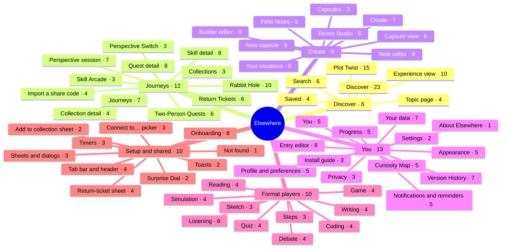

# Elsewhere app map

Every page in the Elsewhere app and what you can do on it: 40 pages across 4 tabs, 10 setup and shared pieces, and 10 format players, 317 tasks in all. The labels are the real button names from the code.

**Interactive version:** https://claude.ai/artifact/2XnoyVdYntcen4tANvff4p (tap a page on the map to jump to its tasks, or filter by a word).

## Mind map

Each branch is a tab or group; each leaf is a page with its number of tasks.

## Contents

- [Discover](#discover) · 6 pages
- [Journeys](#journeys) · 12 pages
- [Create](#create) · 9 pages
- [You](#you) · 13 pages
- [Format players](#format-players) · 10 players
- [Setup & shared](#setup-and-shared) · 10 pieces

## Discover

Find something to try: the feeds, search, topics, Plot Twist and the experience player. 6 pages, 62 tasks.

### Discover

`/discover  (?view=explore | saved)` · 23 tasks · Three views in a pager: For you, Explore and Saved.

- **Gesture:** Swipe between the three views · *or* tabs, Previous / Next view chevrons, arrow keys
- Open search from the icon or the field
- See the Saved count on its tab
- **For you**
  - Pick a topic chip, or All topics; open the Topic page
  - Open Filters: time, energy, format, topics; Reset
  - Clear the active-filter strip
  - Pick up where you left off: a ticket, rabbit hole or draft
  - Surprise me; tap the dial level to change it
  - Open a card, or bookmark it to save
  - **Gesture:** Swipe a feed card right to save it · *or* bookmark icon or the ⋯ menu
  - ⋯ menu: More like this, Less like this, Hide this, Add to collection
  - Why am I seeing this? → Change my preferences
  - **Gesture:** Swipe through the Possibility Shelf · *or* Previous / Next buttons, dots, arrow keys
  - Open the Plot Twist and rabbit-hole teasers
  - End card: Surprise me, Adjust filters, Refresh
- **Explore**
  - Open topic tiles; All topics / Fewer topics
  - Find something that fits: time, energy, format
  - Browse rabbit holes, Skill Arcade and Perspective Switch
  - More ways in: Plot Twist, Two-Person Quests, Collections
- **Saved**
  - Open a saved card
  - **Gesture:** Swipe a saved card left to remove it · *or* bookmark icon
  - Undo an unsave from the toast
  - Browse For you; organise into Collections

Leads to: [Experience view](#p-x), [Search](#p-search), [Topic page](#p-topic), [Plot Twist](#p-twist), [Rabbit Hole](#p-rabbit), [Return Tickets](#p-tickets), [Profile & preferences](#p-sprofile)

### Saved

`/saved` · 4 tasks · The Saved list as its own page.

- Open a saved item
- **Gesture:** Swipe left to unsave · *or* bookmark icon
- Undo from the toast
- Jump to Collections from the header

### Search

`/search?q=` · 6 tasks · Search across everything, on this device.

- Type a query; Clear search
- Filter: ≤ 15 min, ≤ 30 min, Low energy, Medium or less, formats
- Rerun or remove a recent search; Clear all
- Browse topics chips
- Results: topics, experiences, rabbit holes and ideas, skills, perspectives, your notes and entries
- No results: Clear filters, or Surprise me instead

### Topic page

`/topic/<id>` · 4 tasks · One topic’s content, plus feedback on it.

- Follow topic / Following
- More like this / Less, with Undo
- Open its rabbit holes, skills and perspectives
- Save experience cards

### Plot Twist

`/twist  (?id=<twistId>)` · 15 tasks · Small real-world routine breakers.

- Set the Surprise Dial (regenerates the twist)
- Adjust Right now: time, energy, budget, who, where
- Not for me, Reroll or Accept
- **Gesture:** Swipe the card left to reroll, right to accept · *or* the buttons
- Continue a twist in progress
- Open Your twists
- No match: Reset to my usual settings
- **Twist detail**
  - Accept, or Not now
  - Run the optional timer
  - Capture a photo or a note
  - Done — reflect on it: what happened, 1–5 stars, did it break the routine
  - Also save to Version History
  - Edit the reflection; open the linked entry
  - Drop or delete the twist
  - Shared twists → Two-Person Quests

Leads to: [Note editor](#p-note), [Two-Person Quests](#p-quests), [Entry editor](#p-entry)

### Experience view

`/x/<experienceId>` · 10 tasks · The immersive screen where every experience runs.

- Save for later / Remove from saved, with Undo
- More options: More / Less like this, Hide this, Add to collection
- Save a return ticket
- Your own creations: Share or edit in Builder
- Unhide a hidden experience
- Run the optional activity timer
- Step through the guide with dots
- Do the activity in its format player
- What next: Reflect, Capture a field note, Remix, Seal as capsule, Add to collection
- Try next in the real world; Part of a skill; related experiences

Leads to: [Entry editor](#p-entry), [Note editor](#p-note), [Remix Studio](#p-remix), [New capsule](#p-capsulenew), [Builder editor](#p-builderedit), [Skill detail](#p-skill), [Return Tickets](#p-tickets)

## Journeys

Things that unfold over time: rabbit holes, skills, tickets, quests, collections and perspectives. 12 pages, 69 tasks.

### Journeys

`/journeys` · 7 tasks · The hub for everything in progress.

- Header: Return tickets (N open), Import a share code
- Continue: tickets, rabbit holes, skills, quests, perspectives
- Open a rabbit-hole card
- Open a skill; All skills
- Open a perspective question; All questions
- Quests: open recent, start from a template, All quests
- Collections: open one, Manage, Create a collection

Leads to: [Return Tickets](#p-tickets), [Import a share code](#p-import), [Rabbit Hole](#p-rabbit), [Skill Arcade](#p-skills), [Perspective Switch](#p-perspectives), [Two-Person Quests](#p-quests), [Collections](#p-collections)

### Rabbit Hole

`/rabbit/<id>  (?node=<nodeId>)` · 10 tasks · A branching graph of connected ideas.

- Jump back along the breadcrumb trail, or to Start
- Save an Unexpected idea to “Things that surprised me”
- Save discovery, Capture note, Return ticket
- Expand perspective lenses; test your view in Perspective Switch
- Try it: open linked experiences
- Follow this thread: pick a branch
- **Gesture:** Swipe between visited ideas · *or* Previous / Next, ← → keys
- Map: jump to any explored idea
- Finished: Write a reflection
- Leaving early offers Save ticket

Leads to: [Note editor](#p-note), [Return Tickets](#p-tickets), [Perspective session](#p-perspective), [Experience view](#p-x), [Entry editor](#p-entry)

### Skill Arcade

`/skills` · 3 tasks · All five skills.

- Open a skill
- Start here / Continue
- Toggle I’m developing this

### Skill detail

`/skill/<id>` · 8 tasks · Levels, practice and projects for one skill.

- Toggle I’m developing this
- Start / Continue the next step
- Pick a level; preview locked ones
- Open practice and project cards
- Free practice: 5–25 min, timer, note, Log session
- Delete a logged session
- Open saved work
- Turn it into a real-world challenge

Leads to: [Experience view](#p-x), [Remix Studio](#p-remix)

### Return Tickets

`/tickets` · 6 tasks · Unfinished explorations, with notes on where you stopped.

- Resume where you stopped
- Edit a ticket
- Mark resolved
- **Gesture:** Swipe a ticket left to resolve it · *or* Mark resolved button
- Reopen a resolved ticket
- Delete a ticket

### Two-Person Quests

`/quests  (?template=<id>)` · 6 tasks · Shared challenges, passed back and forth by code.

- Open your quests (Waiting shows whose move it is)
- Start a quest from a template
- Write a quest: title, intro, kind, prompts
- Reorder, add or remove prompts
- Discard, or Create quest
- Import a code

### Quest detail

`/quest/<id>` · 8 tasks · Answer, invite and compare.

- Answer each prompt (autosaved)
- Edit prompts, or Delete quest
- Include my answers so they can compare right away
- Create an invitation code or a reply code
- Copy code, Share…, Update the code
- Compare answers side by side
- Capture what you noticed
- Import a reply code

Leads to: [Note editor](#p-note), [Import a share code](#p-import)

### Collections

`/collections` · 3 tasks · Named shelves for anything.

- New collection: name and description
- Open, Rename or Delete a collection
- Restore starter collections

### Collection detail

`/collection/<id>` · 4 tasks · The items on one shelf.

- Edit name and description
- Add things with the Connect picker
- Open, reorder or remove items, with Undo
- Delete collection

### Perspective Switch

`/perspectives` · 3 tasks · Curated questions to see from several sides.

- Continue a session in progress
- Open a question
- Revisit a past session

### Perspective session

`/perspective/<questionId>  (?session=)` · 7 tasks · Your stance before, the lenses, your stance after.

- Set your stance and say why
- Read each lens and write a response
- **Gesture:** Swipe between lens cards · *or* Back / Next lens
- Restate your stance: did your thinking change?
- Record in Version History
- Add to “Ideas I changed my mind about”
- Start again; see earlier sessions

Leads to: [Entry editor](#p-entry), [Collection detail](#p-collection)

### Import a share code

`/import  (?d=<code>)` · 4 tasks · Bring in a shared experience or quest. Works before setup too.

- Paste a code or message, or tap Paste
- Read code to preview it
- Import, Update quest or Import answers
- Open what you imported; Import another

Leads to: [Experience view](#p-x), [Quest detail](#p-quest)

## Create

Capture, remix, build and seal. 9 pages, 53 tasks.

### Create

`/create` · 7 tasks · The hub for making things.

- Quick capture: Text, Voice, Sketch, Photo, Link
- Open a capsule that’s ready
- Continue drafts in progress
- Recent field notes; All
- Start a remix
- New experience; Your creations
- Quick capsules: Prediction, Message, Voice

Leads to: [Note editor](#p-note), [Field Notes](#p-notes), [Remix Studio](#p-remix), [Your creations](#p-builder), [Builder editor](#p-builderedit), [Capsules](#p-capsules), [New capsule](#p-capsulenew)

### Field Notes

`/notes` · 5 tasks · All your quick captures.

- Quick capture tiles
- Search notes; filter by kind and topic
- Open a note
- ••• menu: Mark as private, Remix into an experience, Add to collection, Delete
- **Gesture:** Swipe a note left to delete it · *or* ••• menu → Delete, with Undo

Leads to: [Note editor](#p-note), [Remix Studio](#p-remix)

### Note editor

`/note/new  (?kind=&link=)  ·  /note/<id>` · 8 tasks · Saves as you type.

- Write a title and the note
- Voice: Record, Stop, Record again, play it back
- Sketch on the canvas
- Photo: Take photo, Choose image, Retake, Remove
- Link: web address, Open link
- Topics, Connected to, Private
- Remix this note; Add to collection
- Delete note

Leads to: [Remix Studio](#p-remix)

### Remix Studio

`/remix  (?from=<kind>:<id>)` · 5 tasks · Turn one thing into a new experience, from templates.

- Start from: search, or pick a recent source
- Turn it into: experiment, quiz, challenge, story, letter, debate, project, outdoor walk, writing prompt or two-person quest
- Preview it; Another phrasing
- Edit in Builder, or Start now
- Letter: seal it straight into a capsule

Leads to: [Builder editor](#p-builderedit), [Experience view](#p-x), [New capsule](#p-capsulenew)

### Your creations

`/builder` · 5 tasks · The library of experiences you made.

- New experience; Remix something
- Open or discard a draft
- Made by you, Remixes, Shared with you
- Start, Edit, Duplicate or Delete
- Share for friends → Copy code / Share…

### Builder editor

`/builder/new  ·  /builder/<id>` · 9 tasks · Create or edit an experience.

- Pick a type: quest, quiz or poll, experiment, learning journey, writing prompt, reflection, more formats
- Basics: title, summary, topics
- Steps: instructions, timer, what each step asks for
- Quiz: questions, a right answer or a poll, explanation
- Writing: prompt, word goal, hints
- Conversation: the question and its sides
- Details: minutes, who, energy, comfort zone, cost, follow-ups
- Private, or For friends → Create share code
- Save, Preview, Delete, Discard draft

Leads to: [Experience view](#p-x), [Import a share code](#p-import)

### Capsules

`/capsules` · 3 tasks · Sealed messages to your future self.

- Seal something new: Prediction, Opinion, Message, Voice note, Creation
- Continue an unsealed draft
- Browse Ready to open, Sealed and Opened

### New capsule

`/capsule/new  (?kind=&link=)` · 5 tasks · Compose it, pick when it opens, seal it.

- Pick a kind; a title shown while sealed
- Write it, record up to 5 minutes, or connect a creation
- Opens: 1 week, 1 month, 3 months, 1 year, or a date
- Seal capsule (with a confirm step)
- Discard draft

### Capsule view

`/capsule/<id>` · 6 tasks · Locked, ready to open, or opened.

- Locked: see the countdown; delete without opening
- Ready: Open capsule
- Then: read it, play the voice note, see what it was sealed with
- Now: What do I think now? (autosaved)
- My view has changed → add to Version History
- Delete capsule

Leads to: [Entry editor](#p-entry)

## You

Your timeline, your map, your progress and your settings. 13 pages, 61 tasks.

### You

`/you` · 5 tasks · The hub for your own history.

- See the latest Version History entries; See all
- Add entry: reflection, opinion, interest, goal, milestone, mind change, capsule
- Open the Curiosity Map preview
- Open Progress, Capsules, Collections
- Settings, Import a share code, Install guide

Leads to: [Version History](#p-history), [Entry editor](#p-entry), [Curiosity Map](#p-map), [Progress](#p-progress), [Capsules](#p-capsules), [Collections](#p-collections), [Settings](#p-settings), [Install guide](#p-install)

### Version History

`/history` · 7 tasks · Your timeline of entries and activities.

- Add an entry
- Revisit: Show another past entry, Has this changed?, Read it again
- Capsules: Ready to open, All, Seal
- Search the timeline
- Filter by kind: reflections, opinions, goals, mind changes…
- Tap to reveal private items
- Patterns as literal counts, after 3 or more entries

Leads to: [Entry editor](#p-entry), [New capsule](#p-capsulenew)

### Entry editor

`/entry/new  (?kind=&link=&title=)  ·  /entry/<id>` · 8 tasks · Saves as you type.

- Pick a kind
- Write a title and your words
- Mind change: I used to think → Now I think (required)
- Revise: Save as new version or Fix typo, and why it changed
- Mood, topics, Connected to, Private
- Compare the earliest and current versions
- Seal a follow-up capsule; Add to collection
- Delete, or Done

Leads to: [New capsule](#p-capsulenew)

### Curiosity Map

`/map` · 5 tasks · A map of your own explorations and how they connect.

- Switch between Map and List view
- Show or hide kinds: topics, experiences, Plot Twists, notes…
- Tap a point to see its connections
- Open it, or jump along a connection
- **Gesture:** Drag to pan, pinch or scroll to zoom · *or* Zoom in / Zoom out / Reset view, arrow keys, + − 0, List view

### Progress

`/progress` · 5 tasks · Literal counts. No streaks.

- Continue or open a skill
- Rabbit holes explored
- Completed, by format
- Counts link to twists, perspectives, quests, capsules, history
- Recent saved work

Leads to: [Skill detail](#p-skill), [Rabbit Hole](#p-rabbit), [Plot Twist](#p-twist), [Perspective Switch](#p-perspectives), [Two-Person Quests](#p-quests), [Capsules](#p-capsules), [Version History](#p-history)

### Settings

`/settings` · 2 tasks · The list of sections.

- Open a section
- Open the Install guide

Leads to: [Appearance](#p-sappearance), [Profile & preferences](#p-sprofile), [Notifications & reminders](#p-snotif), [Privacy](#p-sprivacy), [Your data](#p-sdata), [About Elsewhere](#p-sabout), [Install guide](#p-install)

### Appearance

`/settings/appearance` · 5 tasks · How the app looks and moves.

- Pick a theme by its artwork
- Day and night: Auto, Day, Night
- Reduce transparency
- Reduced motion: System, On, Off
- Text size, haptics and sounds

### Profile & preferences

`/settings/profile` · 5 tasks · What suggestions are based on.

- Your name, interests, skills to develop, goals
- Usual time, energy, budget, solo or shared
- Surprise Dial
- Formats you enjoy
- Unhide hidden items; Reset feedback

### Notifications & reminders

`/settings/notifications` · 5 tasks · What can notify you, and when.

- Allow notifications
- Toggle categories: timers, reminders, capsules, shared updates, return tickets
- Quiet hours: from and until
- Create or edit a reminder: what, time, days; switch it on or off
- Send a test notification, or Test in 10 seconds

### Privacy

`/settings/privacy` · 3 tasks · How private items are handled.

- Blur private entries
- Leave private items out of exports
- Export a copy

### Your data

`/settings/data` · 7 tasks · Export, import and delete.

- Export: include media, leave out private items
- Download, Save or Share the export
- Copy export to clipboard (or Select all and copy)
- Import: Choose export file, or Paste to import
- Merge or Replace; old prototype backups are only added
- See how much storage is used
- Delete all data (type DELETE to confirm)

Leads to: [Import a share code](#p-import)

### About Elsewhere

`/settings/about` · 1 task · Version, limits, design and credits.

- Read what the app can and can’t do

### Install guide

`/install` · 3 tasks · Putting Elsewhere on your home screen.

- Install Elsewhere (when the browser offers it)
- Guides: Android APK, Android Chrome, iPhone/iPad Safari, desktop Chrome/Edge
- Jump to export and import

Leads to: [Your data](#p-sdata)

## Format players

What you do inside an experience at /x/&lt;id&gt;, by format. Experiments, projects, challenges, outdoor walks, reflections, together activities and journeys all use the Steps player. 10 players, 40 tasks.

### Reading

`inside /x/<id>` · 4 tasks · Articles and explanations.

- Read with a progress bar
- Continue where you stopped
- Open Sources & further reading
- Done reading

### Quiz

`inside /x/<id>` · 4 tasks · One question at a time.

- Answer A, B, C…
- See feedback and the explanation
- See result, review answers, Try again
- Polls compare with your own last answer

### Steps

`inside /x/<id>` · 3 tasks · Guided activities, step by step.

- Move with step dots, Back, Next, Finish
- Run a step’s timer
- Answer a step: notes, a choice, sketch, photo or voice

### Writing

`inside /x/<id>` · 4 tasks · Prompts with an optional word goal.

- Read the prompt
- Need a nudge? reveal hints
- Write toward the word goal (autosaved)
- Finish, or Save again

### Sketch

`inside /x/<id>` · 3 tasks · Draw to a prompt and constraints.

- Draw with ink pen, accent pen or eraser, in three sizes
- Undo last stroke, Clear sketch, Save sketch
- Finish; see your last sketch

### Listening

`inside /x/<id>` · 6 tasks · Sounds made in the app, plus a silence walk.

- Tones: presets, a free tone with pitch and wave shape, volume
- Soundscape: layers with levels; Stop all
- Rhythm: patterns, tempo, swing
- Mood pair: play clip A and B, answer, reveal what differed
- Silence: a timer, log sounds by distance
- Note what you heard; Finish

### Simulation

`inside /x/<id>` · 4 tasks · Random walk, Life, flocking, waves, spread, sound and mood.

- Play, Pause, Step, Reset
- Change each model with its sliders
- **Gesture:** Tap or drag cells and people on the canvas · *or* Randomise, Add a glider, Start from someone random
- Write what you observed; Finish & save

### Game

`inside /x/<id>` · 4 tasks · Pattern memory, rhythm tap and estimation.

- Pattern memory: tap the pads, or number keys
- Rhythm tap: tap the big button, or Space / Enter
- Estimate: guess, Reveal, Finish
- Save your best run

### Coding

`inside /x/<id>` · 4 tasks · JavaScript exercises run in a sandbox.

- Edit the code (Ctrl/⌘ + Enter runs it)
- Run, Stop, Reset
- See output and checks
- Finish, or Save again

### Debate

`inside /x/<id>` · 4 tasks · Pick a side, read the others, see if you moved.

- Pick a position and say why; Lock it in
- **Gesture:** Swipe between the sides · *or* Previous / Next side, ← → keys
- Where do I stand now?; Save both positions
- Record this change of mind

Leads to: [Entry editor](#p-entry)

## Setup and shared

First launch, plus the pieces that appear on many screens. 10 pieces, 32 tasks.

### Onboarding

`first launch (any route except /import)` · 8 tasks · Nine steps: Welcome, Name, Interests, Skills, Goals, Your rhythm, Formats, Look & feel, Ready.

- Type your name (optional)
- Pick interests and skills to develop
- Pick goals, or write your own
- Set time, energy, Surprise Dial, budget, solo or shared
- Choose formats you enjoy
- Pick a theme artwork; Auto, Day or Night
- Next, Back, Skip this step, Skip setup, Start exploring
- **Gesture:** Swipe between steps · *or* Back / Next

### Not found

`unknown path, or a screen error` · 1 task · Shown when a page doesn’t exist or a screen fails.

- Go to Discover

### Tab bar & header

`every screen` · 4 tasks · Navigation that’s always there.

- Switch tabs: Discover, Journeys, Create, You
- Go back with the header chevron
- **Gesture:** Swipe in from the left edge to go back · *or* Back button
- See the offline and storage banners

### Sheets & dialogs

`many screens` · 3 tasks · Bottom sheets and confirm steps.

- Close with X, Escape or the backdrop
- **Gesture:** Drag a sheet down to dismiss it · *or* Close button
- Confirm or cancel: Delete, Discard, Seal it, Drop it

### Toasts

`many screens` · 2 tasks · Short confirmations at the bottom.

- Undo a save, hide, feedback, resolve or delete
- Follow-ups: View tickets, Save ticket, Edit, Open, View

### Timers

`activities, plus a floating pill` · 3 tasks · Keeps running across screens.

- Start, Pause, Resume, Restart
- Add one minute; Reset timer
- Pill: jump back to the activity, Pause / Resume, Dismiss

### Return-ticket sheet

`rabbit holes, experiences, skills` · 4 tasks · Note where you stopped, for later.

- Where I stopped, What caught my attention, What I want to try next
- Remind me: None, Tomorrow, 3 days, 1 week
- Change an existing reminder
- Save ticket / Save changes

### Add to collection sheet

`cards, experiences, notes, entries` · 2 tasks · File anything onto a shelf.

- Tap a collection to add or remove
- Create a new collection by name

### Connect to… picker

`notes, entries, capsules, collections` · 3 tasks · Link things to each other.

- Search experiences, skills, notes…
- Toggle items, then Done
- Remove a link with its X

### Surprise Dial

`Discover, Plot Twist, onboarding, settings` · 2 tasks · How far outside your comfort zone suggestions go.

- Pick 1 to 5, Familiar → Adventurous
- Arrow keys move the dial

---

Routes are hash routes, so `/rabbit/<id>` opens as `#/rabbit/<id>`. Until setup is finished, every route shows onboarding except `/import`. Sheets, toasts with Undo and timers appear on many pages, so they are listed once under Setup and shared.
